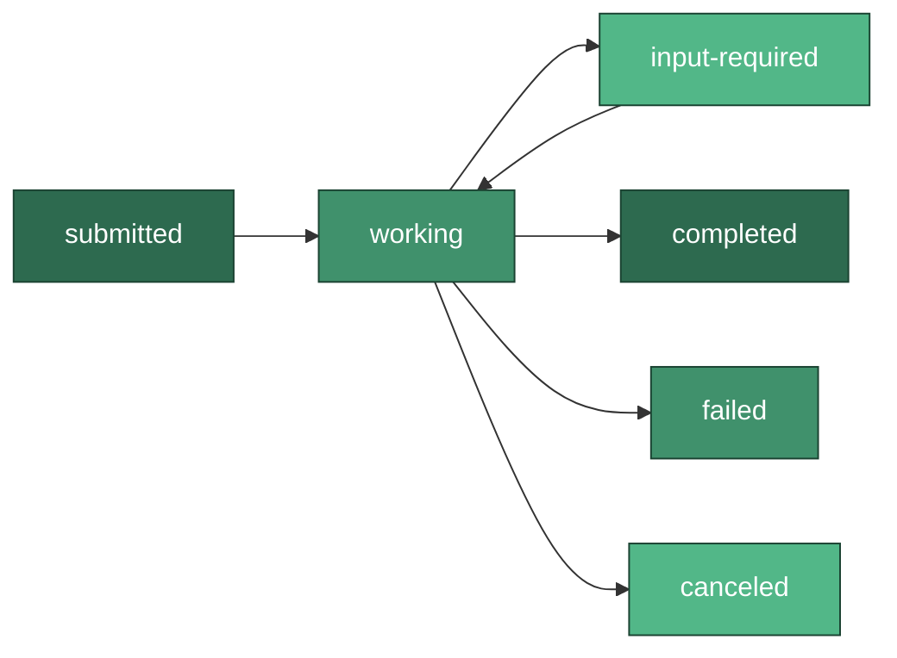
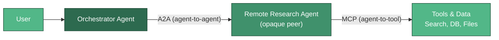

# Agent Interoperability Protocols (A2A)

Most multi-agent systems today run **in-process**: a single codebase wires several agents together with a framework like LangGraph or CrewAI, sharing memory, tools, and state. But the moment agents are built by **different teams, frameworks, or vendors**, that shared-memory assumption breaks. Agent interoperability protocols standardize how autonomous agents discover and delegate work to one another as **opaque peers** across a network boundary -- without exposing their internal state, memory, prompts, or tools. The leading open standard is the **Agent2Agent (A2A)** protocol, originated by Google and now a Linux Foundation project.

:::info Verified 2026-10-12
The [A2A specification](https://a2a-protocol.org/latest/specification/) lists **1.0.0** as the latest released version (GitHub's latest release tag is **v1.0.1**). A2A was [accepted as a Growth Stage project at the Agentic AI Foundation (AAIF)](https://a2a-protocol.org/latest/blog/2026/08/27/a-new-chapter-for-a2a-joining-the-agentic-ai-foundation/), the same Linux Foundation-directed home as MCP (the announcement post is dated August 27, 2026). Pin the version your SDKs actually implement; much older tutorials describe v0.x wire shapes.
:::

---

## When You Need Cross-Vendor Interop

The first design decision is whether you need a wire protocol at all. In-process orchestration is simpler, faster, and easier to debug -- reach for interop protocols only when a real boundary exists.

| Dimension | In-Process Orchestration | Cross-Boundary Interop (A2A) |
|-----------|--------------------------|------------------------------|
| Ownership | One team, one codebase | Different orgs / vendors / teams |
| Framework | Single (LangGraph, CrewAI, AutoGen) | Mixed and independent |
| State sharing | Shared memory and objects | None -- agents are opaque |
| Transport | Function calls | HTTP + JSON-RPC 2.0 over the network |
| Coupling | Tight | Loose, contract-based |
| Discovery | Import / registry in code | Agent Card over HTTP |
| Best for | Cohesive apps, low latency | Federated ecosystems, third-party agents |

:::tip Rule of thumb
If both agents live in the same repository and can `import` each other, use in-process orchestration. Introduce A2A only when you cross an organizational or network boundary and cannot (or should not) see inside the other agent.
:::

---

## A2A

A2A was originally developed by Google and donated to the Linux Foundation (per the [official A2A site](https://a2a-protocol.org/latest/)); it is maintained by a Technical Steering Committee with representatives from AWS, Cisco, Google, IBM Research, Microsoft, Salesforce, SAP, and ServiceNow, and the AAIF announcement says it is backed by over 150 organizations. This page does not state exact introduction or donation dates because the sources checked on 2026-10-12 did not give them; release dates come from the [GitHub releases](https://github.com/a2aproject/A2A/releases) API (v0.3.0 on 2025-07-30, v1.0.0 on 2026-03-12, v1.0.1 on 2026-05-28). It gives independently built agents a common language for delegation.

- **Transport:** v1.0 formally defines three equivalent protocol bindings: **JSON-RPC**, **gRPC**, and **HTTP+JSON/REST**. Each Agent Card interface declares its binding and protocol version; clients send an `A2A-Version` header.
- **Opacity:** A remote agent is a black box. It exposes *what* it can do via its Agent Card, never *how* it does it -- no internal tools, prompts, or memory leak across the boundary. This is the key contrast with in-process multi-agent systems.
- **Long-running work:** Tasks can stream incremental updates (SSE on HTTP bindings) or use push notifications, so a client can delegate a job that takes minutes or hours.

### Core Objects

| Object | Role |
|--------|------|
| **Agent Card** | Machine-readable capability manifest (discovery) |
| **Task** | A unit of work with a lifecycle and a stable ID |
| **Message** | A turn in the conversation between client and agent |
| **Part** | A chunk of content inside a message; v1.0 uses one unified `Part` (text, URL, raw bytes, or data) with `mediaType`, replacing separate TextPart/FilePart/DataPart and `kind` |
| **Artifact** | A durable output the agent produces for a task |

### Task Lifecycle

A task moves through a well-defined set of states (in v1.0 these are `TASK_STATE_*` enum values such as `TASK_STATE_INPUT_REQUIRED`; v0.3 used lowercase names like `input-required`), which lets clients handle async and human-in-the-loop flows predictably.



The spec also defines `rejected` and `auth-required` states; the diagram shows only the common path, and exact transitions should be checked in the spec. The `input-required` state is what makes A2A suitable for real delegation: a remote agent can pause, ask the client for clarification, and resume -- without the client knowing anything about its internals.

---

## Agent Cards

Discovery is anchored on a small JSON document published at a **well-known URL**: `/.well-known/agent-card.json` (the spec's well-known discovery path). A client fetches it to learn an agent's skills, input/output modes, transport, and security schemes before ever sending a task.

```python
# Conceptual / schema-level Agent Card (v1.0 shape) served at /.well-known/agent-card.json
agent_card = {
    "name": "research-agent",
    "description": "Performs multi-source web research and returns cited summaries.",
    "supportedInterfaces": [
        {
            "url": "https://agents.example.com/a2a",
            "protocolBinding": "JSONRPC",
            "protocolVersion": "1.0",
        }
    ],
    "version": "1.0.0",
    "capabilities": {"streaming": True, "pushNotifications": False},
    "defaultInputModes": ["text/plain"],
    "defaultOutputModes": ["text/plain"],
    "skills": [
        {
            "id": "web-research",
            "name": "Web Research",
            "description": "Answer a question with cited sources.",
            "tags": ["research", "search"],
        }
    ],
}
```

Once a client has the card, delegating work is a single JSON-RPC call. The snippet below is **conceptual / schema-level** -- it shows the v1.0 JSON-RPC wire shape (method names `SendMessage`, `GetTask`, ...; v0.3 used `message/send`) rather than binding to any SDK. It was **not executed**, and required Agent Card fields should be checked against the spec.

```python
# Conceptual / schema-level A2A task request (JSON-RPC 2.0 over HTTP)
import json
import httpx  # or `requests`

request = {
    "jsonrpc": "2.0",
    "id": "req-1",
    "method": "SendMessage",
    "params": {
        "message": {
            "role": "ROLE_USER",
            "parts": [{"text": "Summarize the A2A specification."}],
        }
    },
}


def send_task(base_url: str) -> dict:
    response = httpx.post(
        base_url,  # the JSON-RPC interface URL from the Agent Card
        json=request,
        headers={"A2A-Version": "1.0"},
        timeout=30,
    )
    response.raise_for_status()
    return response.json()


print(json.dumps(request, indent=2))
```

:::info Discovery, not invocation
The Agent Card only *advertises* capabilities. It never contains prompts, model names, or tool definitions. The client decides whether the advertised skills fit, then sends a Task -- the agent stays opaque throughout.
:::

---

## The Broader Landscape

A2A is the most visible standard, but it sits in a small ecosystem. Two other efforts matter for interview conversations. (The AGNTCY row is **unverified**: agntcy.org was reachable on 2026-10-12 but its Linux Foundation / July 2025 claim was not found in the fetched page text, so treat that cell as unconfirmed.)

| Initiative | Origin | What It Is | Relationship to A2A |
|------------|--------|------------|---------------------|
| **AGNTCY** | Cisco-led, Linux Foundation (July 2025) | An **infrastructure** layer for an "Internet of Agents" -- identity, discovery, and messaging plumbing | Interoperates with A2A and MCP; **not** a wire-protocol competitor |
| **ACP** | IBM Research | A REST-native agent protocol that powered the open-source **BeeAI** platform | **Merged into A2A**; ACP team winding down active development |

:::info ACP has merged into A2A
A [29 August 2025 LF AI & Data announcement](https://lfaidata.foundation/communityblog/2025/08/29/acp-joins-forces-with-a2a-under-the-linux-foundations-lf-ai-data/) said ACP is merging with A2A under the Linux Foundation, with the ACP team winding down active development and joining A2A's technical steering committee. Treat ACP as a legacy lineage, not a live rival protocol. AGNTCY, meanwhile, is complementary infrastructure -- it provides the "roads" on which A2A traffic can travel.
:::

---

## How A2A Complements MCP

The cleanest mental model: **MCP is agent-to-tool; A2A is agent-to-agent.** (MCP's 2026-07-28 revision is stateless and per-request; see the MCP page. ) The [Model Context Protocol](./model-context-protocol) connects a single agent to its tools, data, and context. A2A connects that agent to *other* agents it does not own. They compose rather than compete.



The orchestrator delegates a task to a remote agent over **A2A**. That remote agent -- entirely opaque to the orchestrator -- privately uses **MCP** to reach its own tools and data. Neither protocol has visibility into the other's layer, which is exactly what keeps the boundary clean.

:::warning Do not reach for A2A too early
A2A adds network latency, auth, and failure modes that in-process calls avoid. If you control both agents and they share a runtime, orchestrate them in code. Adopt A2A when opacity and cross-org delegation are genuine requirements, not defaults.
:::

---

## Common Interview Questions

**Q: What problem does A2A solve that a framework like LangGraph or CrewAI does not?**
In-process frameworks assume shared memory, shared tools, and one codebase. A2A targets the opposite: agents built by different teams or vendors that must collaborate over a network as opaque peers, exposing capabilities but never internal state.

**Q: How is A2A different from MCP?**
MCP connects an agent to its tools and context (agent-to-tool). A2A connects an agent to other agents (agent-to-agent). They are complementary: an agent might expose an A2A endpoint to peers while using MCP internally to reach its tools.

**Q: What does "opaque agent" mean and why does it matter?**
An opaque agent advertises only *what* it can do (via its Agent Card) and never *how*. Its prompts, models, memory, and tools stay private. This enables loose coupling and cross-vendor trust: you integrate against a contract, not an implementation.

**Q: How does a client discover an A2A agent's capabilities?**
It fetches the Agent Card at `/.well-known/agent-card.json`, which declares skills, input/output modes, supported interfaces (binding and version), and security schemes. The client uses this to decide whether the agent fits before sending a Task.

**Q: Is ACP a competitor to A2A?**
No longer. ACP (IBM Research, powering BeeAI) announced in August 2025 that it was merging into A2A under the Linux Foundation. Frame it as consolidated into A2A, alongside complementary infrastructure like Cisco-led AGNTCY.

---

## Official Sources (curl-verified 2026-10-12)

- [AAIF: About](https://aaif.io/about) -- describes AAIF as a neutral foundation under the Linux Foundation hosting MCP, goose, AGENTS.md, A2A, and agentgateway
- [A2A GitHub releases](https://github.com/a2aproject/A2A/releases) -- tag and date source for version statements
- [A2A specification](https://a2a-protocol.org/latest/specification/) and [What's New in v1.0](https://a2a-protocol.org/latest/whats-new-v1/)
- [A2A joins AAIF](https://a2a-protocol.org/latest/blog/2026/08/27/a-new-chapter-for-a2a-joining-the-agentic-ai-foundation/); [AAIF](https://aaif.io/about) lists A2A among hosted projects
- [ACP joins forces with A2A](https://lfaidata.foundation/communityblog/2025/08/29/acp-joins-forces-with-a2a-under-the-linux-foundations-lf-ai-data/)

---

## Further Reading

- [Model Context Protocol](./model-context-protocol) -- The complementary agent-to-tool standard A2A composes with.
- [Multi-Agent Communication](../architecture-design/multi-agent-communication.md) -- Messaging patterns for agents that collaborate.
- [Multi-Agent Pattern](../design-patterns/multi-agent-pattern.md) -- When and how to decompose work across agents.
- [Multi-Agent Crew Implementation](../implementations/multi-agent-crew.md) -- A concrete in-process orchestration example.
- [Framework Comparison](../frameworks/framework-comparison.md) -- Choosing between orchestration frameworks before you reach for a wire protocol.
