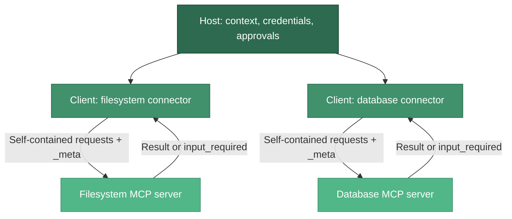
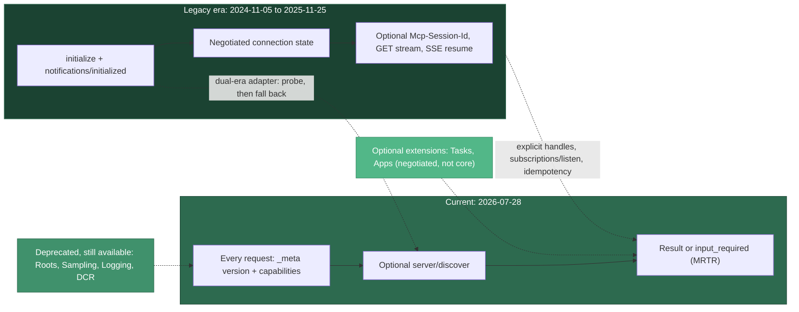
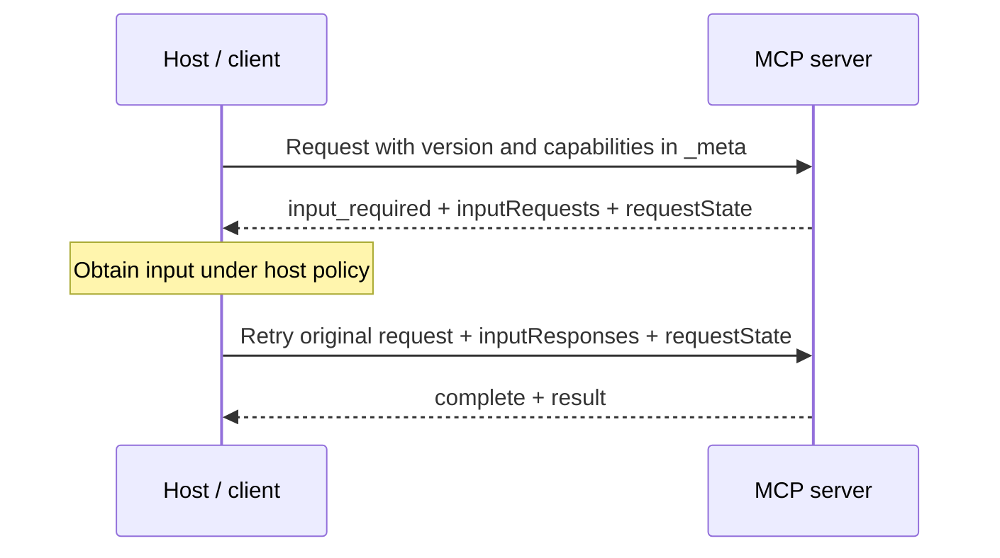

import DiagramEmbed from '@site/src/components/DiagramEmbed';

# Model Context Protocol (MCP)

**MCP is an open protocol for connecting AI applications to tools, data, and reusable prompts.** Introduced by Anthropic in November 2024, it replaces many bespoke connectors with a common contract. The familiar "USB-C for AI" analogy describes integration reuse, not guaranteed compatibility: clients still need a mutually supported revision, capabilities, authentication, and host policy.

:::info Verified 2026-10-12
The official `latest` specification resolves to **2026-07-28**. That revision changes the core from initialization-based sessions to **stateless, self-contained requests**. MCP is hosted by the Linux Foundation's **Agentic AI Foundation (AAIF)**. See the [specification](https://modelcontextprotocol.io/specification/2026-07-28), [changelog](https://modelcontextprotocol.io/specification/2026-07-28/changelog), and [AAIF overview](https://aaif.io/about).
:::

---

## Architecture: Hosts, Clients, Servers

A **host** is the application that manages users, model context, approvals, and integrations. A **client** is its connector to one server. A **server** exposes capabilities. This logical client-server boundary remains useful, but **a dedicated protocol session is no longer required** in the 2026-07-28 core. A transport connection is not the same thing as a stateful application workflow.



The host aggregates capabilities and mediates trust. Separate connectors make failures easier to contain; they do **not** by themselves prevent credential leakage, prompt injection, or cross-server influence through shared model context.

### A stateless tool call

<DiagramEmbed src="/diagrams/mcp-stateless-request.html" title="MCP stateless tool-call sequence">
  Success path for a protected HTTP tool: each request is self-contained, credentials stay
  in the Authorization header, and the host retains approval policy. Token acquisition is
  schematic, not an OAuth implementation guide. Anonymous tools omit that branch.
</DiagramEmbed>

The server validates token audience and permissions before execution. A missing or invalid
access token returns **401**; insufficient scopes or permissions return **403**, not a tool
result. See the [authorization specification](https://modelcontextprotocol.io/specification/2026-07-28/basic/authorization)
(checked 2026-10-12). Optional Tasks, Apps, discovery, and input-required exchanges are not
shown in this simple success path.

### Protocol eras and migration

| Era | Contract | Migration implication |
|---|---|---|
| **2024-11-05** | Initialization handshake; stdio or HTTP+SSE | Keep only for explicitly supported legacy integrations |
| **2025-03-26 through 2025-11-25** | Initialization-based versions; Streamable HTTP replaces HTTP+SSE; optional HTTP sessions | Existing `ClientSession.initialize()` examples belong to this era; experimental Tasks appeared in 2025-11-25 |
| **2026-07-28** | No `initialize`/`notifications/initialized`; per-request version and capabilities; no `Mcp-Session-Id` | Use a modern implementation or a deliberate dual-era adapter, not just a new date string |



In the modern era, `params._meta` carries `io.modelcontextprotocol/protocolVersion` and `io.modelcontextprotocol/clientCapabilities`. Clients **SHOULD** also send `io.modelcontextprotocol/clientInfo`; servers **SHOULD** identify themselves in result `_meta` (`io.modelcontextprotocol/serverInfo`). Servers **MUST** implement `server/discover`; clients may use it to learn versions and capabilities before invoking other methods. An unsupported version returns `UnsupportedProtocolVersionError`.

A dual-era client can probe with `server/discover` on stdio and fall back to initialization for a legacy server. On HTTP, inspect a modern error response before falling back: **a `400` alone does not prove the server is legacy**. A legacy-only client cannot automatically upgrade to a modern-only server. Follow the [compatibility matrix](https://modelcontextprotocol.io/specification/2026-07-28/basic/versioning).

:::warning Deprecation is not removal
The [feature lifecycle policy](https://modelcontextprotocol.io/community/feature-lifecycle) distinguishes **Active, Deprecated, Removed**. A deprecated feature normally remains available for at least **twelve months from the release of the revision first marking it deprecated**; a documented security exception can shorten that window, with a ninety-day floor. Removal requires a later revision. This is **not** an automatic twelve-month expiration of entire protocol revisions: the [revision states](https://modelcontextprotocol.io/docs/learn/versioning) are Draft, Current, and Final.
:::

---

## The Three Primitives

These are the three principal **server-facing primitives**, not an exhaustive list of everything in MCP.

| Primitive | Typical control owner | What it exposes | Example |
|---|---|---|---|
| **Tools** | Model | Executable actions described by schemas | `run_query`, `create_ticket` |
| **Resources** | Application | URI-addressed context loaded by the host | `config://version`, a document |
| **Prompts** | User | Reusable templates or workflows | `/review`, `/summarize` |

These are interaction conventions, not authorization grants. A model proposing a tool call does not grant permission to execute it. A host can automate prompt selection or expose resource-reading tools, but should still explain who selects the context and who approves the action.

### Client features and extensions

The 2026-07-28 core retains **elicitation** for requesting additional user input. Server requests now use **multi round-trip requests (MRTR)**: return `resultType: "input_required"` with `inputRequests`, then the client retries the original request with `inputResponses` and any supplied request state. Ordinary results have `resultType: "complete"`; clients must interpret an omitted discriminator from an earlier-protocol server as complete.



**Roots, Sampling, and Logging are deprecated, not removed.** New implementations should pass file/directory scope as tool arguments, resource URIs, or configuration; use provider APIs directly instead of MCP Sampling; and use stderr for local logs or OpenTelemetry for observability. Deprecated Logging now uses per-request `io.modelcontextprotocol/logLevel`; `logging/setLevel` is removed, and without that metadata servers must not emit `notifications/message`. `notifications/roots/list_changed` and `ping` are also removed.

Optional extensions require explicit support by both sides; do not infer support from the core revision alone:

- **[Tasks](https://modelcontextprotocol.io/extensions/tasks/overview)** moved out of experimental core into `io.modelcontextprotocol/tasks`. Servers can return durable task handles; poll `tasks/get` and supply mid-flight input with `tasks/update`. The old blocking `tasks/result` and `tasks/list` are removed in the redesigned extension.
- **[MCP Apps](https://modelcontextprotocol.io/extensions/apps/overview)** connects tool results to interactive UI resources, typically rendered in a host-controlled sandboxed iframe. UI isolation and permissions are additional responsibilities, not a guarantee that tool content is trustworthy.

---

## Transports

| Transport | Execution boundary | Modern behavior |
|---|---|---|
| **stdio** | Local subprocess | JSON-RPC over stdin/stdout; each request carries metadata; operational logs belong on stderr |
| **Streamable HTTP** | HTTP service | POST requests receive JSON or SSE responses; no protocol-level session ID |

Streamable HTTP replaced the older **HTTP+SSE** transport in 2025-03-26. **SSE itself is not deprecated**: it remains a response format in modern Streamable HTTP. The deprecated transport is the old separate SSE-channel/POST-endpoint design.

In 2026-07-28, `subscriptions/listen` replaces the standalone GET channel and `resources/subscribe`/`resources/unsubscribe` for opted-in change notifications. Progress and per-request log notifications stay on their request's response stream. SSE event IDs, `Last-Event-ID`, resumability, and redelivery are removed: a broken stream requires a new request with a new ID. For side-effecting tools, add application-level idempotency; a fresh JSON-RPC ID does not prevent duplicate writes.

HTTP requests mirror the version in `MCP-Protocol-Version` and the method in `Mcp-Method`; methods with a name/URI also require the appropriate `Mcp-Name`. Validate header/body agreement. See the [transport requirements](https://modelcontextprotocol.io/specification/2026-07-28/basic/transports/streamable-http).

---

## A Minimal MCP Server

**Illustrative wire contract, not a tested server implementation.** Choose an SDK that explicitly implements the target revision. A familiar decorator or import path does not prove 2026-07-28 compatibility.

A minimal addition server implements `server/discover`, `tools/list`, and `tools/call`, validates arguments, and returns JSON-RPC results. An illustrative `tools/list` response is:

```json
{
  "jsonrpc": "2.0",
  "id": 1,
  "result": {
    "resultType": "complete",
    "tools": [{
      "name": "add",
      "description": "Add two numbers.",
      "inputSchema": {
        "type": "object",
        "properties": {"a": {"type": "number"}, "b": {"type": "number"}},
        "required": ["a", "b"]
      }
    }],
    "ttlMs": 300000,
    "cacheScope": "public"
  }
}
```

Modern list results require `ttlMs` and `cacheScope`. Use `private` for identity-dependent data; `public` is appropriate here only because this static schema reveals no private information. The server can additionally expose resources and prompts, but must advertise what it actually supports.

---

## Connecting a Client

**Illustrative Python example; not SDK- or integration-tested.** This sends a single modern tool call, rather than creating an initialization-based session. It assumes a trusted endpoint implementing 2026-07-28 and an already-authorized caller; production clients must handle authentication, discovery, structured errors, SSE, MRTR, and retries.

```python
import os
import httpx

version = "2026-07-28"
request = {
    "jsonrpc": "2.0",
    "id": 2,
    "method": "tools/call",
    "params": {
        "name": "add",
        "arguments": {"a": 2, "b": 3},
        "_meta": {
            "io.modelcontextprotocol/protocolVersion": version,
            "io.modelcontextprotocol/clientCapabilities": {},
            "io.modelcontextprotocol/clientInfo": {
                "name": "interview-demo", "version": "1.0.0"
            },
        },
    },
}
response = httpx.post(
    os.environ["MCP_SERVER_URL"],
    headers={
        "MCP-Protocol-Version": version,
        "Mcp-Method": "tools/call",
        "Mcp-Name": "add",
        "Accept": "application/json, text/event-stream",
    },
    json=request,
    timeout=30,
)
response.raise_for_status()
# This simplified example handles only the JSON response branch.
if "application/json" not in response.headers.get("content-type", ""):
    raise RuntimeError("An SSE-capable client is required for this response")
print(response.json())
```

Workflow state belongs in **explicit server-minted handles passed as ordinary arguments**, not in an assumed connection session. Treat handles as sensitive, authorize them per caller, and bound their lifetime.

---

## Why MCP Matters

MCP decouples integration code from model orchestration: implement a server contract once and reuse it across compatible hosts. The `N × M` to `N + M` connector analogy describes potential reuse, not elimination of all integration work.

- **Common discovery and schemas** reduce bespoke adapters.
- **Separation of concerns** lets tool owners implement operations while hosts manage model context and approvals.
- **Explicit version and capability boundaries** make compatibility testable.

---

## Security Risks

Treat server metadata, tool descriptions, resources, UI, and results as untrusted input. Threats include **tool poisoning**, definition changes after approval ("rug pulls"), indirect prompt injection, confused-deputy actions, and credential theft. Local stdio servers execute code with the subprocess's OS privileges: protocol compliance is not sandboxing.

Hosts must approve and scope tool use; servers must enforce caller authorization on every operation. OAuth authenticates and delegates access, but does not decide whether a model-proposed action is semantically safe.

The 2026-07-28 [OAuth changes](https://modelcontextprotocol.io/specification/2026-07-28/changelog) harden that boundary:

- Authorization servers **SHOULD** include RFC 9207 `iss`; clients **MUST** validate a present issuer before redeeming the code.
- Persist client credentials keyed by the issuing authorization server. Never reuse them with a different issuer; re-register when the server changes.
- OAuth Dynamic Client Registration is **deprecated in favor of Client ID Metadata Documents**, but remains available for backwards compatibility. Where DCR is still used, specify the appropriate `application_type`.

Use least privilege, consent, audited approvals, endpoint validation, and safe retry semantics. See [Security Considerations](../architecture-design/security-considerations.md).

---

## MCP vs a Tool Registry

| Dimension | MCP | Tool registry |
|---|---|---|
| Layer | Wire contract and capability exchange | Catalog and governance |
| Question | "How do we invoke this server?" | "Which integrations may this caller use?" |
| Scope | Client-server interaction | Fleet-wide inventory, versions, ownership, policy |

They compose: a registry can select approved MCP endpoints and revisions; the host and server still enforce policy. Neither the protocol nor a catalog automatically makes a tool safe.

---

## Common Interview Questions

**Q: Does MCP require a 1:1 session and `initialize`?**
Not in 2026-07-28. Clients retain a logical server boundary, but requests carry their own version and capabilities. Initialization belongs to older revisions or explicit dual-era compatibility.

**Q: Who controls the three primitives?**
Conventionally the model proposes tools, the application selects resources, and the user selects prompts. Those labels do not replace approvals or server-side authorization.

**Q: Are Roots and Sampling removed? Are Tasks core?**
Roots, Sampling, and Logging are deprecated and remain functional during the deprecation window. Tasks is now an opt-in extension. Distinguish removal of individual methods from deprecation of whole features.

**Q: Is SSE deprecated?**
The old HTTP+SSE transport is deprecated; SSE responses in Streamable HTTP are not. Modern streams no longer support event-ID replay, so retries require application-level duplicate protection for writes.

**Q: What is the twelve-month rule?**
It is normally a minimum feature-deprecation window measured from the revision release, not a promise to remove a feature exactly then or an expiration date for every old revision.

**Q: How does MCP differ from A2A and a registry?**
MCP connects applications to capabilities; A2A delegates work to remote agents. A registry governs discovery and access. These are complementary layers.

---

## Official Sources (curl-verified 2026-10-12)

- `specification/latest` redirects to [2026-07-28](https://modelcontextprotocol.io/specification/2026-07-28); [changelog](https://modelcontextprotocol.io/specification/2026-07-28/changelog) confirms per-request `_meta`, `server/discover`, MRTR, `ttlMs`/`cacheScope`, `subscriptions/listen`, SSE resumability removal, Tasks extension, and DCR deprecation.
- [Feature lifecycle](https://modelcontextprotocol.io/community/feature-lifecycle): twelve-month minimum deprecation window, ninety-day security floor.
- Not individually re-read in detail: the Apps overview page, and per-SDK support for 2026-07-28 (check each SDK's release notes; **unverified here**).

---

## Further Reading

- [Official 2026-07-28 specification](https://modelcontextprotocol.io/specification/2026-07-28) and [changelog](https://modelcontextprotocol.io/specification/2026-07-28/changelog).
- [Tools and Function Calling](../core-concepts/tools-and-function-calling.md) -- model-level schemas and calls beneath the integration layer.
- [Tool Registry Design](../architecture-design/tool-registry-design.md) -- catalog and governance.
- [Security Considerations](../architecture-design/security-considerations.md) -- trust boundaries and defense patterns.
- [Agent Interoperability Protocols](./agent-interop-protocols.md) -- complementary delegation protocols.
- [Framework Comparison](../frameworks/framework-comparison.md) -- consuming integrations in different runtimes.
