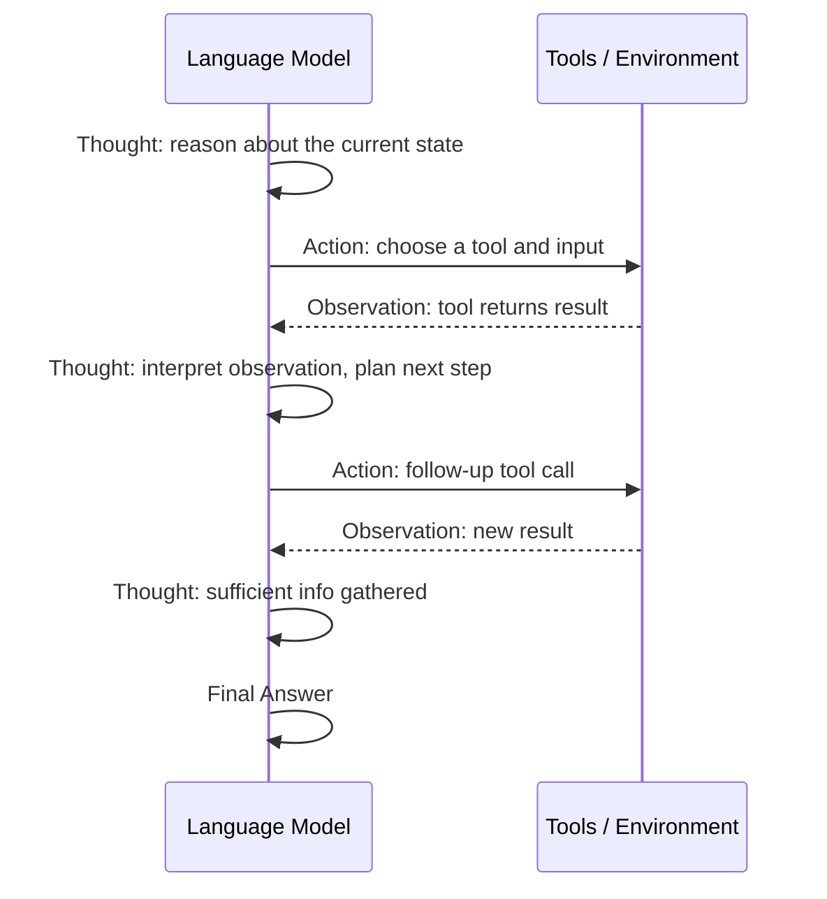

# ReAct (Reason + Act)

ReAct is a prompting and agent-design paradigm that interleaves **reasoning** (chain-of-thought) with **acting** (tool use or environment interaction). Introduced by Yao et al. (2022), it gives language models a structured loop -- Thought, Action, Observation -- that mirrors how humans solve problems: think about what to do, do it, observe the result, and repeat.

## Why ReAct Matters

Traditional chain-of-thought prompting produces reasoning traces but cannot interact with the outside world. Pure action-based agents (e.g., simple tool-calling loops) act without explicit reasoning, making them brittle and hard to debug. ReAct combines both, yielding agents that are **more accurate**, **more interpretable**, and **more grounded** in real information.

:::info Key Insight
ReAct's power comes from the synergy between reasoning and acting. Reasoning helps the agent plan and filter actions; actions bring in fresh information that keeps reasoning grounded.
:::

## The Thought-Action-Observation Loop

The core loop repeats until the agent reaches a final answer or a maximum number of steps:



### Step-by-Step Walkthrough

1. **Thought** -- The model reasons about what to do. For example: *"I need to find the population of France. I should use the search tool."* With modern models this is the (often hidden or summarized) reasoning plus any text content that precedes a tool call.
2. **Action** -- The model emits a **native tool call**: a structured `{name, args}` object validated against the tool's schema, such as `search(query="population of France 2024")`.
3. **Observation** -- The system executes the action and returns the result to the model as an observation.
4. **Repeat** -- The model reads the observation, generates a new thought, and decides whether to act again or produce a final answer.

### Native Tool Calls vs. Text-Parsed ReAct

The original ReAct paper and early frameworks had the model print `Thought:` / `Action:` / `Action Input:` as plain text, which application code parsed with regexes. Today's chat models return tool calls as structured API fields, so the loop is the same but the *Action* is machine-readable and schema-validated. This is the primary approach on this page and in the code below.

| Concern | Native tool calls | Text-parsed ReAct |
|---------|-------------------|-------------------|
| Action format | Structured `tool_calls` with JSON args | Free text parsed by regex |
| Schema validation | Args validated against the tool schema before execution | Hand-rolled; malformed output means retry |
| Parallel calls | Model can return several tool calls in one turn | One action per turn by convention |
| Failure mode | Invalid args become a tool error message the model can fix | Parse errors and hallucinated tool names |

:::tip Interview Point
Why did the industry move from text-parsed ReAct to native tool calling? Reliability: structured calls remove brittle parsing, enable **parallel tool calls** in a single model turn, and allow **schema validation** of arguments before execution (with errors fed back to the model). Keep the Thought/Action/Observation vocabulary for explaining the loop, but implement it with tool calls.
:::

<details>
<summary>Legacy: the historical text-parsed format</summary>

This is how ReAct looked when the model's raw text was the only interface. It is shown for recognition only; do not build new agents this way.

```text
Question: What is the population of France?
Thought: I need to look this up.
Action: search
Action Input: population of France 2024
Observation: The population of France is approximately 68 million (2024).
Thought: I now know the final answer.
Final Answer: About 68 million.
```

```python
# Historical / illustrative: parsing model text before native tool calling.
# Offline-tested for this single-action format; never use it as an execution gate.
import re


def parse_legacy_action(text: str) -> tuple[str, str]:
    match = re.search(r"^Action: ([^\n]+)\nAction Input: ([^\n]+)", text, re.MULTILINE)
    if match is None:
        raise ValueError("Missing historical Action / Action Input pair")
    return match.group(1).strip(), match.group(2).strip()


assert parse_legacy_action("Action: search\nAction Input: population of France") == (
    "search", "population of France"
)
```

This deliberately brittle parser takes only the first action and one input line; it neither validates a tool name against an allowlist nor checks argument schemas. Formatting changes, multiline inputs, and parallel calls break its assumptions. The native implementation below avoids this text-parsing boundary; authorization is still the harness's responsibility.

</details>

## LangChain Implementation: `create_agent`

The simplest path to a production ReAct-style agent is `create_agent` from `langchain.agents` (it replaces the older `langgraph.prebuilt.create_react_agent`). It wires up the Thought-Action-Observation loop as a compiled LangGraph graph with native tool calling. Set `AGENT_MODEL` to a `"<provider>:<model>"` string. Calls that use it (`build_react_agent()` without a model, `run_agent`) are illustrative: they need provider credentials. `ModelCallLimitMiddleware(run_limit=10)` caps model calls per invocation, and the calculator parses arithmetic with `ast` instead of `eval`, so model-supplied text is never executed.

```python
"""ReAct-style agent using langchain.agents.create_agent."""

from __future__ import annotations

import ast
import asyncio
import json
import logging
import math
import operator
import os

from langchain.agents import create_agent
from langchain.agents.middleware import ModelCallLimitMiddleware
from langchain_core.messages import HumanMessage
from langchain_core.tools import tool
from langgraph.checkpoint.memory import InMemorySaver

logger = logging.getLogger(__name__)

# ---------------------------------------------------------------------------
# Tool definitions
# ---------------------------------------------------------------------------

@tool
def search(query: str) -> str:
    """Search the web for current information."""
    fake_results: dict[str, str] = {
        "population of france": "The population of France is approximately 68 million (2024).",
        "capital of japan": "The capital of Japan is Tokyo.",
    }
    return fake_results.get(query.lower(), f"No results found for: {query}")


MAX_EXPR_CHARS = 200
MAX_EXPR_NODES = 50
MAX_ABS_VALUE = 1e12

_BINOPS = {
    ast.Add: operator.add,
    ast.Sub: operator.sub,
    ast.Mult: operator.mul,
    ast.Div: operator.truediv,
}
_UNARYOPS = {ast.UAdd: operator.pos, ast.USub: operator.neg}


def _check_number(value: object) -> float | int:
    """Accept only finite, bounded int/float (bool is an int subclass, so reject it first)."""
    if isinstance(value, bool) or not isinstance(value, (int, float)):
        raise ValueError("only numeric constants are allowed")
    if not math.isfinite(value) or abs(value) > MAX_ABS_VALUE:
        raise ValueError("number is not finite or exceeds the allowed magnitude")
    return value


def _eval_node(node: ast.AST) -> float | int:
    if isinstance(node, ast.Constant):
        return _check_number(node.value)
    if isinstance(node, ast.UnaryOp) and type(node.op) in _UNARYOPS:
        return _check_number(_UNARYOPS[type(node.op)](_eval_node(node.operand)))
    if isinstance(node, ast.BinOp) and type(node.op) in _BINOPS:
        return _check_number(_BINOPS[type(node.op)](_eval_node(node.left), _eval_node(node.right)))
    # Names, attributes, calls, subscripts, exponent, comparisons, ... are all rejected.
    raise ValueError(f"unsupported syntax: {type(node).__name__}")


def safe_arithmetic(expression: str) -> float | int:
    """Evaluate +, -, *, / over numeric literals with bounded size. Never calls eval()."""
    if len(expression) > MAX_EXPR_CHARS:
        raise ValueError("expression too long")
    tree = ast.parse(expression.strip(), mode="eval")
    if sum(1 for _ in ast.walk(tree)) > MAX_EXPR_NODES:
        raise ValueError("expression too complex")
    return _eval_node(tree.body)


@tool
def calculator(expression: str) -> str:
    """Evaluate basic arithmetic (+ - * / and parentheses) and return the result."""
    try:
        return json.dumps({"expression": expression, "result": safe_arithmetic(expression)})
    except (ValueError, SyntaxError, ZeroDivisionError, RecursionError, MemoryError) as exc:
        return json.dumps({"error": f"Invalid expression: {exc}"})


# ---------------------------------------------------------------------------
# Build the agent
# ---------------------------------------------------------------------------

def build_react_agent(model: object | None = None) -> object:
    """Return a compiled LangGraph agent running the ReAct loop."""
    return create_agent(
        # Illustrative: a "<provider>:<model>" string needs provider credentials at run time.
        model=model or os.environ["AGENT_MODEL"],
        tools=[search, calculator],
        system_prompt="Reason step by step and use the tools when you need facts or math.",
        middleware=[ModelCallLimitMiddleware(run_limit=10, exit_behavior="end")],  # per run
        checkpointer=InMemorySaver(),
    )


async def run_agent(question: str) -> str:
    """Execute a question through the agent."""
    graph = build_react_agent()
    config = {"configurable": {"thread_id": "demo-thread"}}
    result = await graph.ainvoke(
        {"messages": [HumanMessage(content=question)]},
        config=config,
    )
    return result["messages"][-1].content
```

:::tip Prebuilt vs. Custom
`create_agent` handles message formatting, tool dispatch, and the reason-act loop internally, and **middleware** (`before_model`, `wrap_tool_call`, `after_model`, summarization, human-in-the-loop) covers most customization. Use middleware for loop policy, as shown next. Move to a custom `StateGraph` when you need a non-standard topology, fully custom state, or routing the standard loop cannot express; see the [LangGraph deep dive](../frameworks/langgraph-deep-dive.md).
:::

## Customizing the Loop with Middleware

When you want to change loop *policy* (limits, tracing, error handling), keep the prebuilt `create_agent` graph and add middleware instead of reimplementing the graph. `ModelCallLimitMiddleware` bounds model calls, and `wrap_tool_call` wraps every tool execution. This block is self-contained (its own small tools). Passing `model=None` uses `AGENT_MODEL`, which is illustrative and needs provider credentials.

```python
"""Customizing the prebuilt ReAct loop with middleware (self-contained)."""

from __future__ import annotations

import logging
import os

from langchain.agents import create_agent
from langchain.agents.middleware import ModelCallLimitMiddleware, wrap_tool_call
from langchain_core.messages import ToolMessage
from langchain_core.tools import tool

logger = logging.getLogger(__name__)


@tool
def get_weather(city: str) -> str:
    """Return deterministic demo weather for a city."""
    return f"Weather in {city}: 20C, clear (demo data)."


@tool
def echo(text: str) -> str:
    """Return the text unchanged."""
    return text


@wrap_tool_call
def trace_tools(request, handler):
    """Log every tool call with its status; turn exceptions into error ToolMessages."""
    name = request.tool_call["name"]
    try:
        result = handler(request)
    except Exception as exc:  # noqa: BLE001 - boundary: report, never crash the loop
        logger.warning("tool=%s status=error error=%s", name, exc)
        return ToolMessage(
            content=f"Tool error: {type(exc).__name__}: {exc}",
            tool_call_id=request.tool_call["id"],
            status="error",
        )
    logger.info("tool=%s status=%s", name, getattr(result, "status", "ok"))
    return result


def build_middleware_agent(model: object | None = None) -> object:
    """Prebuilt loop plus policy: per-run model-call limit and tool tracing."""
    return create_agent(
        model=model or os.environ["AGENT_MODEL"],  # illustrative: needs credentials
        tools=[get_weather, echo],
        middleware=[
            ModelCallLimitMiddleware(run_limit=5, exit_behavior="end"),
            trace_tools,
        ],
    )
```

With `exit_behavior="end"` the run stops with a well-formed AI message once the limit is reached; use `"error"` to raise instead. `run_limit` counts per invocation, while `thread_limit` counts across a checkpointed thread.

:::tip Prebuilt vs. Custom
Choose `create_agent` plus middleware (`ModelCallLimitMiddleware`, `wrap_tool_call`, `before_model`, `after_model`, summarization, human-in-the-loop) for limits, tracing, error handling, and approvals. Drop to a custom `StateGraph` only for a nonstandard topology, such as parallel branches, multiple agents, or routing the standard loop cannot express. See the [LangGraph deep dive](../frameworks/langgraph-deep-dive.md).
:::

## When to Use ReAct

ReAct excels in scenarios that require **multi-step information gathering and reasoning**:

- **Question answering with retrieval** -- The agent searches, reads, and synthesizes across multiple sources.
- **Data analysis tasks** -- Reason about which query to run, execute it, interpret results, refine.
- **Customer support bots** -- Look up account info, reason about policies, take actions.
- **Code debugging** -- Read error logs, hypothesize causes, run diagnostic commands.

:::warning When ReAct Is Overkill
For single-step tool calls (e.g., "What is the weather in Paris?"), a simple tool-calling agent is faster and cheaper. ReAct's overhead only pays off when the task requires multiple reasoning-action cycles.
:::

## Limitations

| Limitation | Description |
|------------|-------------|
| **Latency** | Each step requires an LLM call, so multi-step tasks are slow. |
| **Cost** | More steps mean more tokens. A 6-step ReAct trace can cost 5-10x a single call. |
| **Hallucinated actions** | The model may invent tool names or produce malformed actions. |
| **Premature termination** | The model sometimes declares a final answer before gathering enough information. |
| **Error compounding** | A wrong observation early in the loop can derail subsequent reasoning. |

## Comparison with Other Patterns

| Dimension | ReAct | Chain-of-Thought | Plan-and-Execute |
|-----------|-------|-------------------|-------------------|
| **Reasoning** | Interleaved with actions | Upfront, no actions | Upfront plan, then execute |
| **Grounding** | High -- uses real tool outputs | Low -- relies on parametric knowledge | Medium -- plan may be stale |
| **Flexibility** | Adapts each step | Fixed reasoning chain | Can revise plan, but heavier |
| **Latency** | Medium (sequential steps) | Low (single call) | High (plan + execute phases) |
| **Best for** | Multi-step retrieval & reasoning | Simple reasoning tasks | Complex multi-stage workflows |

## Best Practices

1. **Limit max steps** -- Always set a ceiling to prevent runaway loops and control cost.
2. **Use native tool calling** -- `create_agent` / `bind_tools` eliminates regex parsing errors and gives you schema validation and parallel calls.
3. **Inject few-shot examples** -- Show the model 1-2 complete example tool-use traces (as message turns) when tool selection is ambiguous.
4. **Log every step** -- The trace is ReAct's greatest debugging asset. Use structured logging with step counts.
5. **Add a fallback** -- If the agent hits max steps, escalate to a human or a more capable model.

## Key Takeaways

- ReAct fuses reasoning and acting into a single, interpretable loop.
- The Thought-Action-Observation cycle keeps the agent grounded in real observations.
- Choose `create_agent` plus middleware for limits, tracing, and error policy; use a custom `StateGraph` only for nonstandard topology (see the [LangGraph deep dive](../frameworks/langgraph-deep-dive.md)).
- Use it when tasks demand multi-step information gathering; skip it for trivial single-tool calls.

## Further Reading

- Yao, S. et al. "ReAct: Synergizing Reasoning and Acting in Language Models" (ICLR 2023)
- Shinn, N. et al. "Reflexion: Language Agents with Verbal Reinforcement Learning" (NeurIPS 2023)
- LangChain `create_agent` documentation and the LangChain v1 migration guide (from `langgraph.prebuilt.create_react_agent`)
