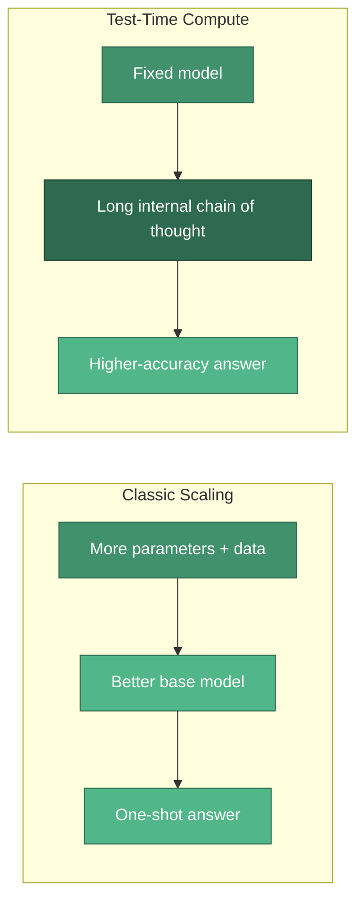
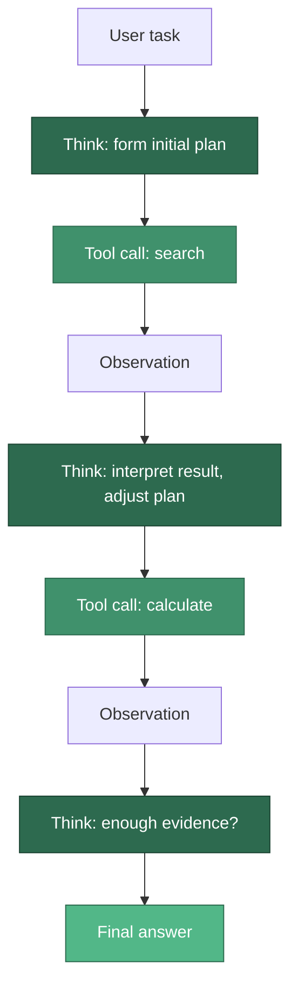
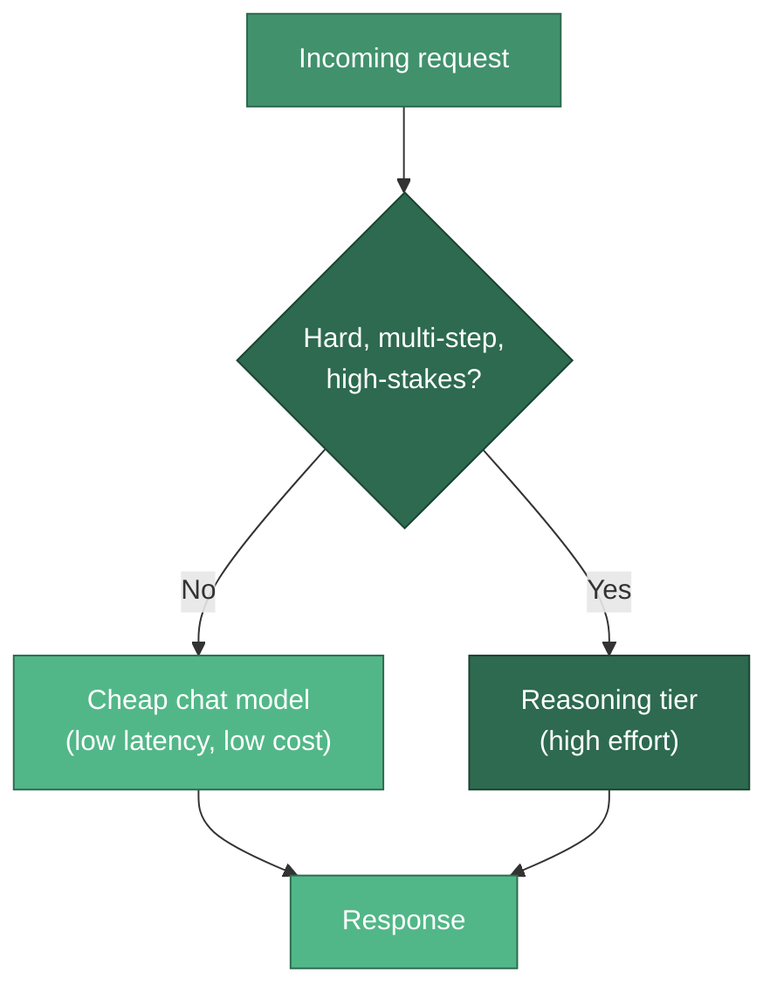

# Reasoning Models & Test-Time Compute

**Reasoning models** -- OpenAI's reasoning models, Anthropic's thinking-capable models, Google's thinking models, and open-weight reasoning models -- are LLMs trained to spend extra *inference-time* compute generating an internal chain of thought before they answer. They trade latency and token cost for higher accuracy on hard, multi-step problems (math, coding, planning, proofs). This **test-time compute** is a dial you control per request: OpenAI exposes `reasoning.effort`, and Anthropic exposes **adaptive thinking** steered by `output_config.effort`. Engineers can tune depth and route only the hard steps to a reasoning tier.

:::info Verified 2026-10-12
Parameters below were checked against the live [OpenAI reasoning guide](https://developers.openai.com/api/docs/guides/reasoning), Anthropic [effort](https://platform.claude.com/docs/en/build-with-claude/effort) and [thinking](https://platform.claude.com/docs/en/build-with-claude/thinking-steering-and-cost) pages. **Supported values and defaults are model-dependent**; read the per-model table before shipping. This page deliberately names no model IDs and no prices: set the model via environment variables and read prices from the provider's pricing page.
:::

---

## What Changed: Test-Time Compute

For years, the dominant scaling lever was **training compute** -- bigger models, more data, longer pretraining. Reasoning models add a second, orthogonal lever: **inference compute**. Instead of answering in a single forward pass, the model generates a long internal reasoning trace first, effectively "thinking longer" on the same fixed weights.



This differs from **prompted** chain-of-thought (adding "let's think step by step" to a normal model). Here the reasoning is a *product of training* -- the model was reinforcement-trained to produce useful reasoning traces, so its thinking is longer, more self-correcting, and more reliable than anything you can coax out of a base model with a prompt.

:::info CoT-as-a-product vs prompted CoT
On a base model you *ask* for step-by-step reasoning. On a reasoning model the reasoning is baked in -- and manually appending "think step by step" is redundant and can even hurt quality. Let the model do what it was trained to do.
:::

---

## Controlling Reasoning Depth

Both major vendors now steer depth with **effort levels**, not a hand-picked token budget. Treat effort as a behavioral signal, not a strict token cap.

| Provider | Control | Values | Reasoning visible? | Billing |
|---|---|---|---|---|
| OpenAI (Responses API) | `reasoning.effort` (Chat Completions: flat `reasoning_effort`) | Model-dependent; may include `none`, `minimal`, `low`, `medium`, `high`, `xhigh`, `max`. Some models reject `none` or `minimal` with HTTP 400 | Raw trace hidden; optional `summary` where the model supports it | Reasoning tokens billed as output tokens |
| Anthropic (Messages API) | `thinking: {"type": "adaptive"}` plus `output_config.effort` | `low`, `medium`, `high`, `xhigh`, `max`; availability and default vary by model | Summarized or omitted via a display setting; billing is for the full thinking | Thinking tokens billed as output tokens |

```python
import os
from openai import OpenAI

client = OpenAI()
resp = client.responses.create(
    model=os.environ["OPENAI_REASONING_MODEL"],  # set per environment
    reasoning={"effort": "medium"},  # confirm this level for your model
    max_output_tokens=4000,  # caps reasoning + visible output together
    input="Prove there are infinitely many primes.",
)
print(resp.output_text)
if resp.status == "incomplete":
    print(resp.incomplete_details)  # may happen before any visible text
print(resp.usage.output_tokens_details.reasoning_tokens)
```

```python
import os
import anthropic

client = anthropic.Anthropic()
msg = client.messages.create(
    model=os.environ["ANTHROPIC_MODEL"],  # set per environment
    max_tokens=16000,  # hard limit on thinking + answer
    thinking={"type": "adaptive"},
    output_config={"effort": "high"},  # effort is NOT inside `thinking`
    messages=[{"role": "user", "content": "Solve this logic puzzle: ..."}],
)
for block in msg.content:
    if block.type == "thinking":
        print("[reasoning]", block.thinking[:200])
    elif block.type == "text":
        print("[answer]", block.text)
```

**Illustrative, not executed here.** Whether your installed SDK version types `output_config` as a keyword is **unverified**; if not, pass it through the SDK's extra-body mechanism or upgrade. The Chat Completions usage field name for reasoning tokens was not re-verified in this pass.

Operational points confirmed in the docs:

- **Effort affects all output tokens**, including text, tool-call arguments, and thinking, so it works with or without thinking. Lower effort also means fewer and terser tool calls.
- **Defaults differ by model.** Setting effort to the model's default is the same as omitting it. Changing effort between requests can invalidate prompt-cache breakpoints; pick a level per conversation.
- **Set a generous `max_tokens` / `max_output_tokens`** at high effort. A response can end `incomplete` after spending the whole cap on reasoning.
- On OpenAI's stateless mode (`store: false` or ZDR), reasoning items carry `encrypted_content` so reasoning can be passed back across turns; Anthropic similarly asks you to return thinking blocks during tool use (**details not re-verified here**).

<details>
<summary>Legacy: fixed thinking budgets (<code>budget_tokens</code>)</summary>

Older Claude models used `thinking: {"type": "enabled", "budget_tokens": N}`. Per Anthropic's extended-thinking page this manual mode is **deprecated on the Claude 4.6 family** (requests still succeed) and **rejected with HTTP 400 on 4.7 and later**. It remains the only thinking mode on 4.5 and earlier models. Use it only when you must support such models; for new work use adaptive thinking with `output_config.effort`.

</details>

:::info Model IDs drift
Every snippet reads the model from an environment variable on purpose. Confirm current identifiers, supported effort levels, and prices in the provider docs rather than copying them from a tutorial.
:::

---

## Interleaved / Extended Thinking

In an agent loop, reasoning does not have to happen only once at the start. **Interleaved thinking** lets the model reason *between* tool calls -- read a tool result, think about what it means, then decide the next call. On models with adaptive thinking this interleaving happens automatically with no beta header; model-by-model behavior differs, so check the [thinking docs](https://platform.claude.com/docs/en/build-with-claude/thinking-steering-and-cost).



This is the reasoning-model analogue of the classic [ReAct loop](../core-concepts/planning-and-reasoning.md), except the "reason" step is a trained capability rather than a prompt template -- the model self-corrects after each observation without an explicit scaffold telling it to.

---

## When to Route to a Reasoning Tier

Reasoning models are not a free upgrade. They cost more and respond slower, so the winning pattern is a **router**: send easy, latency-sensitive traffic to a cheap chat model and escalate only genuinely hard steps to the reasoning tier.



**Route to a reasoning tier when** the task involves multi-step math, non-trivial code, complex planning, ambiguous requirements, or high-stakes decisions where a wrong answer is expensive. **Stay on a cheap model when** the task is classification, extraction, simple Q&A, formatting, or anything latency-sensitive and user-facing.

:::tip Use effort as a knob, not a switch
You do not have to choose between "reasoning on" and "off". Start at `low`/`medium` effort, measure accuracy, and only raise the dial for the specific step types that need it.
:::

---

## Cost & Latency Tradeoffs

The extra reasoning is not free -- those internal tokens are real tokens the model generates and you pay for them.

:::warning Reasoning tokens are billed
Reasoning/thinking tokens count as **output tokens** on your bill. OpenAI's reasoning tokens are *hidden* (you never see the trace) but still charged -- surfaced in `usage.output_tokens_details.reasoning_tokens` on the Responses API. Higher effort spends more tokens (and money) per call, and it can noticeably increase time-to-first-token (TTFT) because the model must finish thinking before it emits the visible answer.
:::

| Setting | Accuracy on hard tasks | Latency (TTFT) | Cost |
|---|---|---|---|
| Lowest effort the model supports | Baseline | Fastest | Lowest |
| `low` / `medium` effort | Better | Moderate | Moderate |
| `high` and above | Best on hard tasks, not guaranteed | Slowest | Highest |

Exact multipliers depend on the model and task, so **measure your own workload** and take prices from the provider's pricing page (kept out of this page on purpose).

For streaming user experiences, the TTFT hit matters: a reasoning model may appear "stuck" for several seconds while it thinks. Budget for it, show a thinking indicator, or route latency-sensitive paths away from the reasoning tier entirely.

---

## Implications for Agent Planning

Reasoning models change how much scaffolding your agent needs. A lot of classic agent engineering -- elaborate [chain-of-thought](../design-patterns/chain-of-thought.md) prompts, explicit [reflection](../design-patterns/reflection-pattern.md) passes, verbose ReAct templates -- existed to squeeze reasoning out of models that were not trained for it. A reasoning-tier model already plans, self-critiques, and backtracks internally.

- **Less prompt scaffolding.** You can drop long "think step by step, then check your work" instructions; the model does this by default.
- **Higher plan quality per call.** One reasoning call often produces a better plan than several rounds of a cheaper model with a ReAct loop -- sometimes at comparable total cost once you count the extra loop iterations.
- **New cost surface.** The savings from fewer orchestration steps must be weighed against per-call reasoning-token cost. Measure end-to-end, not per-request.

:::info Right tool, right step
The pragmatic architecture is hybrid: a reasoning tier for planning and hard sub-problems, cheaper models for routine tool-driven steps. See the [LLM Gateway project](../projects/llm-gateway.md) for how to implement effort-aware routing in practice.
:::

---

## Common Interview Questions

<details>
<summary><strong>Q: What is "test-time compute" and how does it differ from scaling model size?</strong></summary>

Model-size scaling adds parameters and training data to build a stronger base model -- it is a *training-time* investment paid once. Test-time compute keeps the weights fixed but lets the model spend more tokens *at inference* generating an internal chain of thought before answering. It is an orthogonal lever: you can dial reasoning up or down per request without retraining, trading latency and token cost for accuracy on hard multi-step problems.

</details>

<details>
<summary><strong>Q: How do OpenAI and Anthropic differ in how you control reasoning depth?</strong></summary>

Both steer depth with effort levels, and supported levels and defaults are model-dependent. OpenAI uses `reasoning.effort` (Responses API; flat `reasoning_effort` in Chat Completions), hides the raw reasoning trace, and bills reasoning tokens as output. Anthropic uses adaptive thinking (`thinking: {"type": "adaptive"}`) with `output_config.effort` -- not a field inside `thinking` -- and returns summarized or omitted thinking while billing the full thinking tokens. The older fixed-budget Anthropic mode is covered only in the collapsed Legacy note above.

</details>

<details>
<summary><strong>Q: A teammate hardcodes "think step by step in detail" into every prompt to a reasoning model. What do you tell them?</strong></summary>

On a reasoning model that instruction is redundant -- the model was reinforcement-trained to produce reasoning traces on its own, and manually forcing verbose prompted CoT can actually degrade quality or waste tokens. The right control is the vendor knob (effort level via `reasoning.effort` or `output_config.effort`), not prompt engineering the chain of thought.

</details>

<details>
<summary><strong>Q: When would you NOT use a reasoning model?</strong></summary>

For simple, latency-sensitive, or high-volume tasks: classification, extraction, formatting, simple Q&A, and any interactive path where TTFT matters. Reasoning models can cost noticeably more and add seconds of latency before the first visible token. Route those requests to a cheap chat model and reserve the reasoning tier for genuinely hard, high-stakes steps.

</details>

<details>
<summary><strong>Q: Why do reasoning models reduce the need for explicit ReAct scaffolding?</strong></summary>

Much ReAct/reflection scaffolding existed to coax reasoning and self-correction out of models that were not trained for it. A reasoning model plans, critiques, and backtracks internally -- and with interleaved thinking it can even reason between tool calls -- so a single high-quality reasoning call often replaces several loop iterations of a cheaper model. The tradeoff shifts from "how many orchestration steps" to "how many reasoning tokens", so you measure end-to-end cost rather than per-request.

</details>

---

## Further Reading

- [Planning and Reasoning](../core-concepts/planning-and-reasoning.md) -- the agent loop reasoning operates within.
- [Chain-of-Thought Pattern](../design-patterns/chain-of-thought.md) -- prompted CoT vs trained reasoning.
- [Reflection Pattern](../design-patterns/reflection-pattern.md) -- self-critique that reasoning models partly internalize.
- [LLM Fundamentals](./llm-fundamentals.md) -- tokens, sampling, and inference basics.
- [LLM Gateway Project](../projects/llm-gateway.md) -- implementing effort-aware routing.
- [OpenAI: Reasoning models guide](https://developers.openai.com/api/docs/guides/reasoning) (curl-verified 2026-10-12)
- [Anthropic: Effort](https://platform.claude.com/docs/en/build-with-claude/effort) and [Thinking](https://platform.claude.com/docs/en/build-with-claude/thinking-steering-and-cost) (curl-verified 2026-10-12)
- [Anthropic: Extended thinking (legacy)](https://platform.claude.com/docs/en/build-with-claude/extended-thinking)
