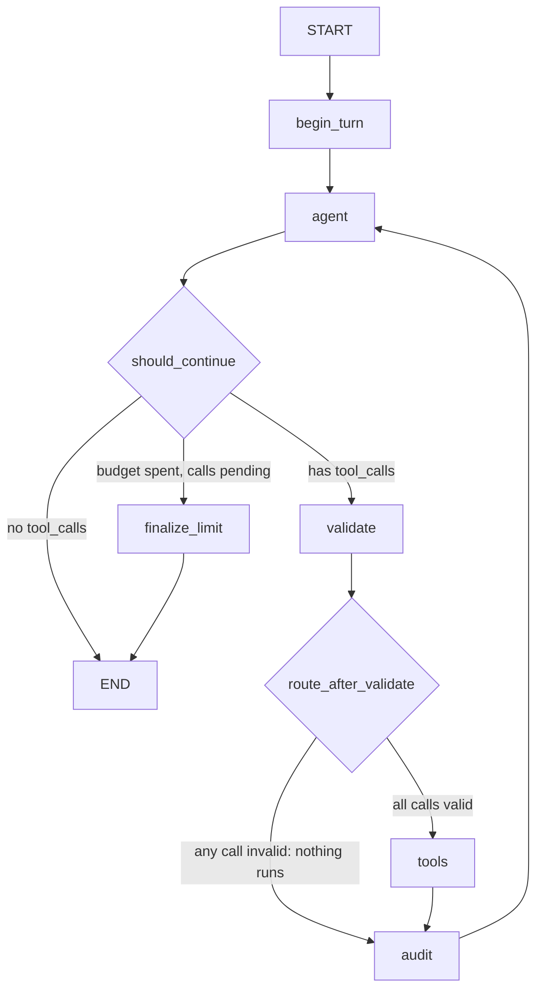

# Tool-Calling Agent with LangGraph

This implementation builds a **tool-calling agent** using LangGraph's prebuilt components. The agent uses structured tool calls (not free-text parsing), supports parallel tool execution, validates results with Pydantic, and includes production patterns like rate limiting, audit logging, and dynamic tool selection.

:::info Why LangGraph for Tool Calling?
LangGraph's `ToolNode` handles tool dispatch, error wrapping, and message formatting in a single reusable component. Combined with the explicit graph structure, you get full control over the tool execution lifecycle -- retries, validation, and audit -- without reimplementing the plumbing.
:::

---

## Architecture



A **begin_turn** node resets the per-turn model-call budget. The **agent** node invokes the LLM with bound tools. If tool calls are returned, they pass through an **all-or-nothing validation** node: if any call has an unknown name or fails its Pydantic schema, *no* tool runs, every call gets one error `ToolMessage`, and the graph bypasses `tools` straight to **audit** and back to the agent so it can self-correct. Only a fully valid batch reaches the prebuilt **ToolNode**. When the budget is spent with calls still pending, **finalize_limit** answers each pending call with an error `ToolMessage` plus a fallback `AIMessage`, so the checkpointed history stays well-formed for the next turn.

:::tip Preferred current path: `create_agent` + middleware
For most production agents, start with LangChain v1's `create_agent` and its middleware instead of hand-writing the graph. It already provides the model/tool loop, per-run call limits, and tool-call wrappers. The explicit `StateGraph` below is kept as the educational view of the same state topology (and for when you need custom routing).

```python
"""native_agent.py -- Illustrative: the same tools on create_agent + middleware.

Illustrative only: calling build_native_agent() needs AGENT_MODEL and provider credentials.
"""

from __future__ import annotations

import json
import os

from langchain.agents import create_agent
from langchain.agents.middleware import (
    ModelCallLimitMiddleware,
    ToolCallLimitMiddleware,
    wrap_tool_call,
)
from langchain_core.messages import ToolMessage

from tools import ALL_TOOLS


@wrap_tool_call
def tool_safety(request, handler):
    """Turn tool exceptions into structured error ToolMessages the model can react to."""
    try:
        return handler(request)
    except Exception as exc:  # noqa: BLE001 - boundary: report, never crash the loop
        return ToolMessage(
            content=json.dumps({"error": f"{type(exc).__name__}: {exc}"}),
            tool_call_id=request.tool_call["id"],
            status="error",
        )


def build_native_agent():
    return create_agent(
        model=os.environ["AGENT_MODEL"],  # e.g. "openai:<model-id>"; see the shared models page
        tools=ALL_TOOLS,
        middleware=[
            ModelCallLimitMiddleware(run_limit=10, exit_behavior="end"),  # per invocation
            ToolCallLimitMiddleware(run_limit=20),
            tool_safety,
        ],
    )
```
:::

---

## Install Dependencies

```bash
pip install langchain langgraph langchain-openai langchain-core pydantic
```

---

## Step 1: Define Tools with Pydantic Schemas

```python
"""tools.py -- Tool definitions with Pydantic input schemas."""

from __future__ import annotations

import ast
import json
import math
import operator
from datetime import datetime, timezone

from langchain_core.tools import tool
from pydantic import BaseModel, Field


class WeatherInput(BaseModel):
    """Input schema for the weather tool."""
    location: str = Field(description="City name, e.g. 'New York'.")
    unit: str = Field(default="celsius", description="Temperature unit: celsius or fahrenheit.")


class CalculatorInput(BaseModel):
    """Input schema for the calculator tool."""
    expression: str = Field(
        max_length=200,
        description="Arithmetic with numbers, + - * / and parentheses only.",
    )


class DatabaseSearchInput(BaseModel):
    """Input schema for the database search tool."""
    query: str = Field(description="Search query string.")
    table: str = Field(default="products", description="Table to search: products or customers.")


class CreateTicketInput(BaseModel):
    """Input schema for the ticket creation tool."""
    customer_name: str = Field(description="Name of the customer.")
    subject: str = Field(description="Brief subject line for the ticket.")
    priority: str = Field(default="medium", description="Ticket priority: low, medium, high, critical.")
    description: str = Field(default="", description="Detailed description of the issue.")


@tool(args_schema=WeatherInput)
def get_weather(location: str, unit: str = "celsius") -> str:
    """Get current weather for a location. Returns temperature, condition, and humidity."""
    mock_data = {
        "new york": {"temp": 22, "condition": "Partly cloudy", "humidity": 65},
        "london": {"temp": 15, "condition": "Overcast", "humidity": 80},
        "tokyo": {"temp": 28, "condition": "Sunny", "humidity": 55},
    }
    city = location.lower().strip()
    data = mock_data.get(city)
    if not data:
        return json.dumps({"error": f"No weather data for '{location}'."})

    temp = data["temp"]
    if unit == "fahrenheit":
        temp = round(temp * 9 / 5 + 32)

    return json.dumps({"location": location, "temperature": temp, "unit": unit, **data})


MAX_EXPR_CHARS = 200
MAX_EXPR_NODES = 50
MAX_ABS_VALUE = 1e12

_BINOPS = {
    ast.Add: operator.add,
    ast.Sub: operator.sub,
    ast.Mult: operator.mul,
    ast.Div: operator.truediv,
}
_UNARYOPS = {ast.UAdd: operator.pos, ast.USub: operator.neg}


def _check_number(value: object) -> float | int:
    """Accept only finite, bounded int/float (bool is an int subclass, so reject it first)."""
    if isinstance(value, bool) or not isinstance(value, (int, float)):
        raise ValueError("only numeric constants are allowed")
    if not math.isfinite(value) or abs(value) > MAX_ABS_VALUE:
        raise ValueError("number is not finite or exceeds the allowed magnitude")
    return value


def _eval_node(node: ast.AST) -> float | int:
    if isinstance(node, ast.Constant):
        return _check_number(node.value)
    if isinstance(node, ast.UnaryOp) and type(node.op) in _UNARYOPS:
        return _check_number(_UNARYOPS[type(node.op)](_eval_node(node.operand)))
    if isinstance(node, ast.BinOp) and type(node.op) in _BINOPS:
        return _check_number(_BINOPS[type(node.op)](_eval_node(node.left), _eval_node(node.right)))
    # Names, attributes, calls, subscripts, exponent, comparisons, ... are all rejected.
    raise ValueError(f"unsupported syntax: {type(node).__name__}")


def safe_arithmetic(expression: str) -> float | int:
    """Evaluate +, -, *, / over numeric literals with bounded size. Never calls eval()."""
    if len(expression) > MAX_EXPR_CHARS:
        raise ValueError("expression too long")
    tree = ast.parse(expression.strip(), mode="eval")
    if sum(1 for _ in ast.walk(tree)) > MAX_EXPR_NODES:
        raise ValueError("expression too complex")
    return _eval_node(tree.body)


@tool(args_schema=CalculatorInput)
def calculate(expression: str) -> str:
    """Evaluate a basic arithmetic expression (+ - * / and parentheses) and return the result."""
    try:
        return json.dumps({"expression": expression, "result": safe_arithmetic(expression)})
    except (ValueError, SyntaxError, ZeroDivisionError, RecursionError, MemoryError) as exc:
        return json.dumps({"error": f"Invalid expression: {exc}"})


@tool(args_schema=DatabaseSearchInput)
def search_database(query: str, table: str = "products") -> str:
    """Search the internal database for products or customer records."""
    mock_db = {
        "products": [
            {"id": 1, "name": "Widget Pro", "price": 49.99, "stock": 150},
            {"id": 2, "name": "Widget Lite", "price": 19.99, "stock": 300},
            {"id": 3, "name": "Enterprise Suite", "price": 299.00, "stock": 50},
        ],
        "customers": [
            {"id": 101, "name": "Alice", "plan": "enterprise", "since": "2023-01"},
            {"id": 102, "name": "Bob", "plan": "pro", "since": "2024-03"},
        ],
    }
    results = mock_db.get(table, [])
    q = query.lower()
    filtered = [r for r in results if q in json.dumps(r).lower()]
    return json.dumps({"table": table, "query": query, "results": filtered or results})


@tool(args_schema=CreateTicketInput)
def create_ticket(
    customer_name: str,
    subject: str,
    priority: str = "medium",
    description: str = "",
) -> str:
    """Create a new customer support ticket and return the ticket ID."""
    ticket_id = f"TKT-{datetime.now(timezone.utc).strftime('%Y%m%d%H%M%S')}"
    return json.dumps({
        "ticket_id": ticket_id,
        "customer_name": customer_name,
        "subject": subject,
        "priority": priority,
        "status": "open",
    })


ALL_TOOLS = [get_weather, calculate, search_database, create_ticket]
```

---

## Step 2: Define the State

```python
"""state.py -- Agent state for the tool-calling graph."""

from __future__ import annotations

from typing import Annotated, Any, Sequence
from langchain_core.messages import BaseMessage
from langgraph.graph.message import add_messages
from pydantic import BaseModel, Field


class AuditEntry(BaseModel):
    """A single audit log entry for a tool invocation."""
    tool_name: str
    arguments: dict[str, Any]
    result_preview: str
    timestamp: str


class ToolAgentState(BaseModel):
    """State for the tool-calling agent graph.

    Tracks conversation messages, audit log, and iteration metadata.
    """

    messages: Annotated[Sequence[BaseMessage], add_messages] = Field(
        default_factory=list,
    )
    audit_log: list[AuditEntry] = Field(
        default_factory=list,
        description="Ordered log of all tool invocations.",
    )
    iteration_count: int = 0  # model calls in the CURRENT user turn (reset by begin_turn)
    total_tool_calls: int = 0

    class Config:
        arbitrary_types_allowed = True
```

---

## Step 3: Build the Graph Nodes

```python
"""nodes.py -- Agent, validation, tool, and audit nodes."""

from __future__ import annotations

import json
import logging
from datetime import datetime, timezone
from typing import Any

from langchain_core.messages import AIMessage, ToolMessage
from langchain_openai import ChatOpenAI
from langgraph.prebuilt import ToolNode
from pydantic import ValidationError

from state import AuditEntry, ToolAgentState
from tools import ALL_TOOLS
import os

MODEL = os.environ["AGENT_MODEL"]

logger = logging.getLogger(__name__)

MAX_ITERATIONS = 10


def create_agent_model(model_name: str = MODEL) -> ChatOpenAI:
    """Create the LLM with all tools bound.

    Separated for dependency injection in tests.
    """
    llm = ChatOpenAI(model=model_name, temperature=0.0)
    return llm.bind_tools(ALL_TOOLS)


_model = create_agent_model()


async def agent_node(state: ToolAgentState) -> dict[str, Any]:
    """Invoke the LLM with the current conversation and tool bindings."""
    logger.info("Agent node | iteration=%d", state.iteration_count)
    response = await _model.ainvoke(state.messages)
    return {
        "messages": [response],
        "iteration_count": state.iteration_count + 1,
    }


async def begin_turn(state: ToolAgentState) -> dict[str, Any]:
    """Reset the per-turn model-call budget; the checkpointed counter would otherwise accumulate."""
    return {"iteration_count": 0}


def _tool_error(tc: dict[str, Any], message: str) -> ToolMessage:
    return ToolMessage(
        content=json.dumps({"error": message}),
        tool_call_id=tc["id"],
        name=tc["name"],
        status="error",
    )


async def validate_tool_calls(state: ToolAgentState) -> dict[str, Any]:
    """All-or-nothing validation of the pending tool calls.

    Every call must name a known tool and satisfy that tool's Pydantic input
    schema. If ANY call is invalid, nothing is executed: each original call
    gets exactly one error ToolMessage (the invalid ones say why, the valid
    ones say they were skipped) and the graph routes around ToolNode.
    """
    last_message = state.messages[-1]
    tool_calls = getattr(last_message, "tool_calls", None)
    if not tool_calls:
        return {}

    tools_by_name = {t.name: t for t in ALL_TOOLS}
    problems: dict[str, str] = {}
    for tc in tool_calls:
        tool = tools_by_name.get(tc["name"])
        if tool is None:
            logger.warning("Unknown tool requested: %s", tc["name"])
            problems[tc["id"]] = f"Unknown tool: {tc['name']}"
            continue
        try:
            tool.args_schema.model_validate(tc["args"])
        except ValidationError as exc:
            problems[tc["id"]] = f"Invalid arguments for {tc['name']}: {exc.errors(include_url=False, include_input=False)}"

    if not problems:
        return {}

    return {
        "messages": [
            _tool_error(
                tc,
                problems.get(tc["id"], "Not executed: another tool call in this batch was invalid. Fix it and resend."),
            )
            for tc in tool_calls
        ]
    }


def route_after_validate(state: ToolAgentState) -> str:
    """Valid batch: the last message is still the AIMessage -> run tools.
    Rejected batch: validate appended error ToolMessages -> bypass tools."""
    return "rejected" if isinstance(state.messages[-1], ToolMessage) else "tools"


# Prebuilt ToolNode handles dispatch, error wrapping, and parallel execution.
tool_node = ToolNode(ALL_TOOLS)


async def audit_log_node(state: ToolAgentState) -> dict[str, Any]:
    """Record tool invocations in the audit log for compliance.

    Reads the most recent ToolMessages and pairs them with the
    preceding AIMessage's tool_calls to build audit entries.
    """
    new_entries: list[AuditEntry] = []
    tool_call_count = 0

    # Walk backwards to find tool messages from the last tool execution
    for msg in reversed(state.messages):
        if isinstance(msg, ToolMessage):
            tool_call_count += 1
            # Find the matching tool call from the AIMessage
            entry = AuditEntry(
                tool_name=msg.name or "unknown",
                arguments={},
                result_preview=msg.content[:200] if msg.content else "",
                timestamp=datetime.now(timezone.utc).isoformat(),
            )
            new_entries.append(entry)
        elif isinstance(msg, AIMessage):
            break

    logger.info("Audit: logged %d tool calls", len(new_entries))
    return {
        "audit_log": state.audit_log + list(reversed(new_entries)),
        "total_tool_calls": state.total_tool_calls + tool_call_count,
    }


def should_continue(state: ToolAgentState) -> str:
    """Conditional edge: validate pending tool calls, finish, or stop at the budget."""
    last_message = state.messages[-1]
    if not getattr(last_message, "tool_calls", None):
        return "end"
    if state.iteration_count >= MAX_ITERATIONS:
        logger.warning("Max iterations reached with tool calls pending.")
        return "limit"
    return "validate"


async def finalize_limit(state: ToolAgentState) -> dict[str, Any]:
    """Close out pending tool calls so the persisted history stays well-formed.

    Each pending call gets one ToolMessage, then a fallback AIMessage ends the
    turn. Without this, the next turn would start with an AIMessage whose
    tool_calls have no results, which providers reject.
    """
    pending = state.messages[-1].tool_calls
    results = [_tool_error(tc, "Not executed: the iteration limit for this turn was reached.") for tc in pending]
    fallback = AIMessage(
        content="I reached the tool-use limit for this request before finishing. "
        "Please narrow the request or try again."
    )
    return {"messages": [*results, fallback]}


```

:::warning Validation Before Execution
The `validate_tool_calls` node checks tool names and Pydantic schemas for the whole batch before `ToolNode` runs. If any call is invalid, **no** call executes (so there are no partial side effects and no duplicate ToolMessages); the model gets one structured error per call and can resend a corrected batch. The calculator never uses `eval`: it walks the parsed AST and allows only bounded numeric literals with unary `+/-` and `+ - * /`.
:::

---

## Step 4: Assemble the Graph

```python
"""graph.py -- Build the tool-calling agent graph."""

from __future__ import annotations

from langgraph.graph import StateGraph, START, END
from langgraph.checkpoint.memory import MemorySaver

from state import ToolAgentState
from nodes import (
    agent_node, audit_log_node, begin_turn, finalize_limit,
    route_after_validate, should_continue, tool_node, validate_tool_calls,
)


def build_tool_agent(checkpointer=None):
    """Construct and compile the tool-calling agent graph.

    Args:
        checkpointer: State persistence backend. Defaults to MemorySaver.

    Returns:
        A compiled LangGraph application.
    """
    if checkpointer is None:
        checkpointer = MemorySaver()

    graph = StateGraph(ToolAgentState)

    # -- Nodes --
    graph.add_node("begin_turn", begin_turn)
    graph.add_node("agent", agent_node)
    graph.add_node("validate", validate_tool_calls)
    graph.add_node("tools", tool_node)
    graph.add_node("audit", audit_log_node)
    graph.add_node("finalize_limit", finalize_limit)

    # -- Edges --
    graph.add_edge(START, "begin_turn")
    graph.add_edge("begin_turn", "agent")

    graph.add_conditional_edges(
        "agent",
        should_continue,
        {"validate": "validate", "limit": "finalize_limit", "end": END},
    )
    graph.add_edge("finalize_limit", END)

    # A rejected batch bypasses `tools`: validate already answered every call.
    graph.add_conditional_edges(
        "validate",
        route_after_validate,
        {"tools": "tools", "rejected": "audit"},
    )
    graph.add_edge("tools", "audit")
    graph.add_edge("audit", "agent")

    return graph.compile(checkpointer=checkpointer)
```

---

## Step 5: Multi-Turn Conversation with Memory

```python
"""main.py -- Multi-turn conversation demonstrating tool calling with memory."""

import asyncio
import logging

from langchain_core.messages import HumanMessage, SystemMessage

from graph import build_tool_agent

logging.basicConfig(level=logging.INFO, format="%(asctime)s %(name)s %(message)s")

SYSTEM_PROMPT = (
    "You are a helpful customer support assistant for Acme Corp. "
    "Use tools for all factual lookups. Use the calculator for math. "
    "Be concise and professional."
)


async def run_conversation() -> None:
    """Run a scripted multi-turn demo showing tool chaining and memory."""
    app = build_tool_agent()

    # Same thread_id across all messages = shared memory
    config = {"configurable": {"thread_id": "demo-conversation"}}

    conversation = [
        "What products do you have and how much do they cost?",
        "If I buy 5 Widget Pros and 10 Widget Lites, what is my total?",
        "What is the weather in Tokyo right now?",
        "Create a ticket for customer Alice about a billing discrepancy, high priority.",
        "Can you look up Alice's account details?",
    ]

    # Seed with system message on first turn
    first_messages = [
        SystemMessage(content=SYSTEM_PROMPT),
        HumanMessage(content=conversation[0]),
    ]

    result = await app.ainvoke({"messages": first_messages}, config=config)
    print(f"Agent: {result['messages'][-1].content}\n")

    # Subsequent turns: just send the human message; memory handles context
    for user_msg in conversation[1:]:
        print(f"User: {user_msg}")
        result = await app.ainvoke(
            {"messages": [HumanMessage(content=user_msg)]},
            config=config,
        )
        print(f"Agent: {result['messages'][-1].content}")
        print(f"  [Tool calls so far: {result['total_tool_calls']}]\n")

    # Print audit log
    print("=" * 60)
    print("AUDIT LOG")
    print("=" * 60)
    for entry in result["audit_log"]:
        print(f"  {entry.timestamp} | {entry.tool_name} | {entry.result_preview[:80]}")


if __name__ == "__main__":
    asyncio.run(run_conversation())
```


---

## Step 6: Dynamic Tool Selection

```python
"""dynamic_tools.py -- Select tools dynamically based on conversation context."""

from __future__ import annotations

from typing import Any

from langchain_core.messages import AIMessage
from langchain_openai import ChatOpenAI
from pydantic import BaseModel, Field

from state import ToolAgentState
from tools import ALL_TOOLS
import os

MODEL = os.environ["AGENT_MODEL"]


class ToolSelection(BaseModel):
    """Structured output for dynamic tool selection."""
    selected_tools: list[str] = Field(
        description="Names of tools relevant to the current query."
    )
    reasoning: str = Field(description="Why these tools were selected.")


async def dynamic_tool_selector(state: ToolAgentState) -> dict[str, Any]:
    """Analyze the conversation and bind only relevant tools.

    This reduces the tool schema size in the prompt, improving
    accuracy for models that struggle with large tool sets.
    """
    llm = ChatOpenAI(model=MODEL, temperature=0.0)
    structured_llm = llm.with_structured_output(ToolSelection)

    last_human = None
    for msg in reversed(state.messages):
        if msg.type == "human":
            last_human = msg.content
            break

    if not last_human:
        return {}

    tool_names = [t.name for t in ALL_TOOLS]
    selection = await structured_llm.ainvoke(
        f"Available tools: {tool_names}\n"
        f"User query: {last_human}\n"
        f"Which tools are relevant?"
    )

    selected = [t for t in ALL_TOOLS if t.name in selection.selected_tools]
    if not selected:
        selected = ALL_TOOLS  # Fallback to all tools

    # Rebind the model with the reduced tool set
    model = ChatOpenAI(model=os.environ["AGENT_MODEL"], temperature=0.0).bind_tools(selected)
    response = await model.ainvoke(state.messages)

    return {"messages": [response]}
```

:::tip When to Use Dynamic Tool Selection
When your agent has more than 10 tools, the tool schemas consume significant prompt tokens and can confuse the model. Dynamic selection prunes the tool set per query, improving both accuracy and cost.
:::

---

## Step 7: Cost and Rate Tracking

```python
"""tracking.py -- Cost and rate tracking for production deployments."""

from __future__ import annotations

import time
from collections import deque
from pydantic import BaseModel, Field


class UsageTracker(BaseModel):
    """Track API usage, costs, and rate limits across conversations."""

    prompt_tokens: int = 0
    completion_tokens: int = 0
    tool_calls_count: int = 0
    api_calls_count: int = 0
    # USD per 1M tokens, required and non-negative: build from PRICING_INPUT_PER_MILLION /
    # PRICING_OUTPUT_PER_MILLION (your pricing config). There are deliberately no defaults.
    price_in_per_million: float = Field(ge=0, description="USD per 1M prompt tokens")
    price_out_per_million: float = Field(ge=0, description="USD per 1M completion tokens")

    @property
    def total_tokens(self) -> int:
        return self.prompt_tokens + self.completion_tokens

    @property
    def estimated_cost(self) -> float:
        return (
            self.prompt_tokens * self.price_in_per_million
            + self.completion_tokens * self.price_out_per_million
        ) / 1_000_000

    def summary(self) -> str:
        return (
            f"API calls: {self.api_calls_count} | "
            f"Tool calls: {self.tool_calls_count} | "
            f"Tokens: {self.total_tokens:,} | "
            f"Est. cost: ${self.estimated_cost:.4f}"
        )


class RateLimiter:
    """Simple sliding-window rate limiter for API calls."""

    def __init__(self, max_calls: int = 20, window_seconds: float = 60.0):
        self._max_calls = max_calls
        self._window = window_seconds
        self._timestamps: deque[float] = deque()

    def acquire(self) -> bool:
        """Check if a call is allowed under the rate limit."""
        now = time.monotonic()
        while self._timestamps and now - self._timestamps[0] > self._window:
            self._timestamps.popleft()
        if len(self._timestamps) >= self._max_calls:
            return False
        self._timestamps.append(now)
        return True

    def wait_time(self) -> float:
        """Seconds to wait before the next call is allowed."""
        if len(self._timestamps) < self._max_calls:
            return 0.0
        return self._window - (time.monotonic() - self._timestamps[0])
```

---

## Key Takeaways for Interviews

:::tip Interview Talking Points
1. **LangGraph's `ToolNode` is production-ready.** It handles dispatch, error wrapping, and parallel execution out of the box -- no custom tool loop needed.
2. **Pydantic tool schemas are self-documenting.** The model receives structured descriptions, reducing hallucinated arguments compared to plain-text descriptions.
3. **All-or-nothing validation before execution** rejects a whole batch if any call is invalid, so there are no partial side effects, and gives the LLM a structured error to self-correct. Never `eval` model-provided text: use a bounded AST evaluator.
4. **Audit logging is non-negotiable in enterprise.** Every tool call must be recorded for compliance, debugging, and cost attribution.
5. **Multi-turn memory via checkpointing** means the agent remembers context across messages without manually threading conversation history.
6. **Dynamic tool selection** reduces prompt size and improves accuracy when the tool set is large.
7. **Rate limiting** prevents API quota exhaustion in high-throughput deployments.
:::

---

## LangGraph ToolNode vs. Manual Tool Loop

| Aspect | LangGraph ToolNode | Manual Loop |
|---|---|---|
| Error handling | Wraps exceptions as ToolMessages | Must implement try/except |
| Parallel execution | Built-in for multiple tool_calls | Must use ThreadPoolExecutor |
| Message formatting | Automatic ToolMessage construction | Manual message assembly |
| Validation | Add-on validation node | Must build from scratch |
| Testing | Mock tools via dependency injection | Mock raw API responses |
| Observability | Graph-level streaming + LangSmith | Custom logging |
